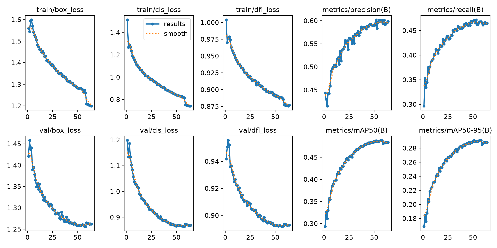

# DroneVision-YOLOv11

用 **YOLO11s** 在 **VisDrone2019-DET** 上做无人机视角的目标检测，配一个 **PyQt5** 上位机界面。

> 个人项目 / Personal project

VisDrone 的特点是**小目标极多**（约 41% 的目标短边不足 16 像素）、**类别极不均衡**（最多与最少相差 42 倍），
所以除了训练本身，这个项目花了不少力气做**误差归因**：判断失败到底是"目标小"造成的，还是"场景密"造成的。

---

## 结果

| 指标 | 数值 |
|---|---|
| mAP@0.5 | **0.478** |
| mAP@0.5:0.95 | **0.288** |
| Precision / Recall | 0.598 / 0.469 |
| 推理速度 | 10.8 ms / 张（896 分辨率） |

模型 YOLO11s（9,431,662 参数），训练 64 epochs / 7.5 小时，峰值显存 6.04 / 8.00 GB（RTX 4060 Laptop）。

**逐类 AP@0.5**：car 0.843 · bus 0.639 · motor 0.562 · pedestrian 0.551 · van 0.516 ·
truck 0.451 · people 0.415 · tricycle 0.352 · bicycle 0.246 · awning-tricycle 0.173



---

## 目录结构

```
├── code/
│   ├── app/main.py            PyQt5 上位机（图片 / 视频 / 摄像头检测）
│   └── train/
│       ├── convert.py         VisDrone 标注 → YOLO 格式
│       ├── train.py           训练
│       ├── detect.py          推理
│       └── _check_train.py    训练前配置自检
├── tools/                     数据集统计与误差归因脚本
└── report/
    ├── 实验结果与分析.md       误差归因与结论
    └── figures/               训练曲线、混淆矩阵、界面截图
```

数据集、预训练权重、训练产出的 `.pt` 都不入库，见下方「复现」。

---

## 复现

安装依赖：

```bash
pip install -r requirements.txt
```

核心版本：Python 3.12 / torch 2.11.0+cu128 / ultralytics 8.4.178 / PyQt5 5.15.11

数据：从 [VisDrone 官方](http://aiskyeye.com/) 下载 **VisDrone2019-DET**，解压到 `dataset_visdrone/` 下，
得到 `raw_train/`、`raw_val/`，然后：

```bash
# 1) 标注格式转换（VisDrone → YOLO），同时生成 VisDrone.yaml
python tools/convert_visdrone.py

# 2) 训练
python code/train/train.py

# 3) 验证（总体指标 + 逐类 AP）
python tools/val.py

# 4) 推理（图片 / 文件夹 / 视频 / 摄像头）
python tools/predict_demo.py <源路径>

# 5) 上位机界面
python code/app/main.py
```

脚本里的路径都靠 `Path(__file__)` 推导项目根，clone 到任意位置都能直接跑。

---

## 两个必踩的坑

1. **`YOLO_CONFIG_DIR` 必须在 `import ultralytics` 之前设置**
   否则框架会往用户目录 `AppData/Roaming/Ultralytics/` 写配置，多项目共存时互相污染。

2. **`ultralytics`（torch）必须先于 `PyQt5` 导入**
   顺序反了会报 `OSError [WinError 1114] Error loading torch/lib/c10.dll`，已实测复现。

---

## 几点结论

- **类别不均衡要按有效样本量看**：`awning-tricycle` 只有 0.173，`car` 有 0.843，差 4.9 倍，
  与两者标注数量之比基本吻合。

- **"密集"不是独立因素**：按目标密度分桶，越密召回越低（70.7% → 55.0%）；但把尺寸固定住再看
  （32–96 像素这一列：81.6 / 81.0 / 84.3 / 81.4），密度的影响几乎消失。真正的原因是
  **密集场景里小目标更多**，而不是"密集"本身。

- **验证集上的最优不等于泛化最优**：best.pt 与 last.pt 的 mAP@0.5 只差 0.0034，
  说明按 val 选权重的选择偏置很小，但报数时仍应声明口径。

详细分析见 [`report/实验结果与分析.md`](report/实验结果与分析.md)。
